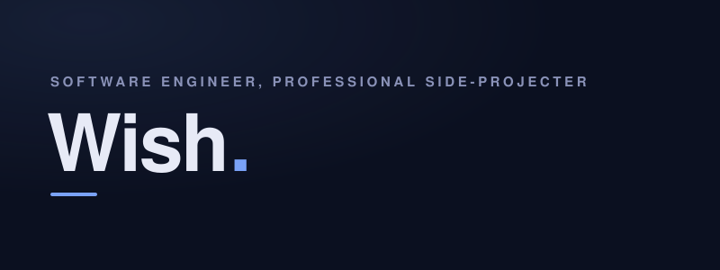
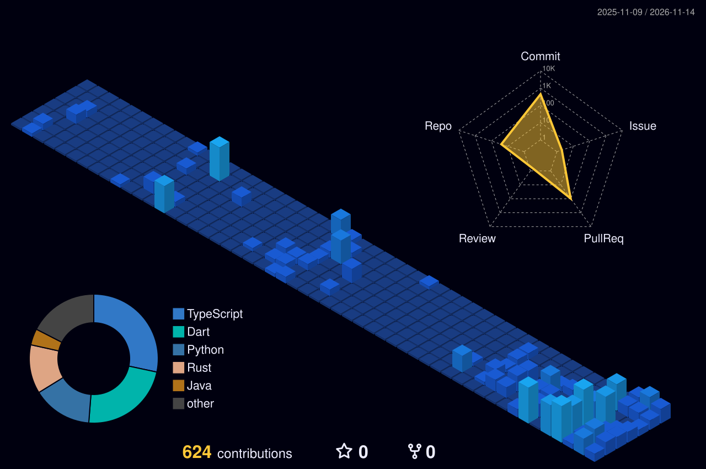

  <picture>
    <source media="(prefers-color-scheme: dark)" srcset="https://raw.githubusercontent.com/ruck-syu/ruck-syu/25c4cd4/assets/header-dark.svg" />
    <source media="(prefers-color-scheme: light)" srcset="https://raw.githubusercontent.com/ruck-syu/ruck-syu/25c4cd4/assets/header-light.svg" />
    
  </picture>

## Works

**[Voxi](https://github.com/ruck-syu/Voxi)** — A Mac menu-bar app that turns typed or dictated commands into safe, previewed file operations. Deletes go to the Trash, and "undo last" reverses the newest run.
 Tauri · Rust · React · TypeScript

**[Deployment Approval Agent](https://github.com/ruck-syu/deployment-approval-agent)** — An AI agent that reviews deployment requests. The LLM advises, a deterministic policy engine decides, and every step lands in an audit log.
 Java 21 · Spring Boot · PostgreSQL · LangChain4j

**[Blast Radius](https://github.com/ruck-syu/blast-radius)** — Supply-chain vulnerability triage over a graph: find every affected service, rank it by exposure, and act only on a verified path.
 Python · FalkorDB · MCP · LLM agents

**[NAWI Testing](https://github.com/ruck-syu/nawi-testing)** — Digital OIML R76 test reports for weighing instruments. Every verdict is computed from the readings, never typed.
 React 19 · Node.js · PostgreSQL · Supabase

**[Anigen](https://github.com/ruck-syu/Anigen)** — A minimalist, ad-free anime client for Android, built with Flutter and an MPV-based player.
 Flutter · Dart · Android

[More repositories →](https://github.com/ruck-syu?tab=repositories)

## GitHub, lately

  <picture>
    <source media="(prefers-color-scheme: dark)" srcset="https://raw.githubusercontent.com/ruck-syu/ruck-syu/output/profile-night-view.svg" />
    <source media="(prefers-color-scheme: light)" srcset="https://raw.githubusercontent.com/ruck-syu/ruck-syu/output/profile-green-animate.svg" />
    
  </picture>

  <picture>
    <source media="(prefers-color-scheme: dark)" srcset="https://github-readme-stats.vercel.app/api?username=ruck-syu&show_icons=true&theme=tokyonight&hide_border=true&count_private=true&include_all_commits=true&hide_rank=true&card_width=495&hide=stars%2Cissues&show=prs_merged%2Cprs_merged_percentage" />
    <source media="(prefers-color-scheme: light)" srcset="https://github-readme-stats.vercel.app/api?username=ruck-syu&show_icons=true&theme=vue&count_private=true&include_all_commits=true&hide_rank=true&card_width=495&hide=stars%2Cissues&show=prs_merged%2Cprs_merged_percentage" />
    
  </picture>

  

